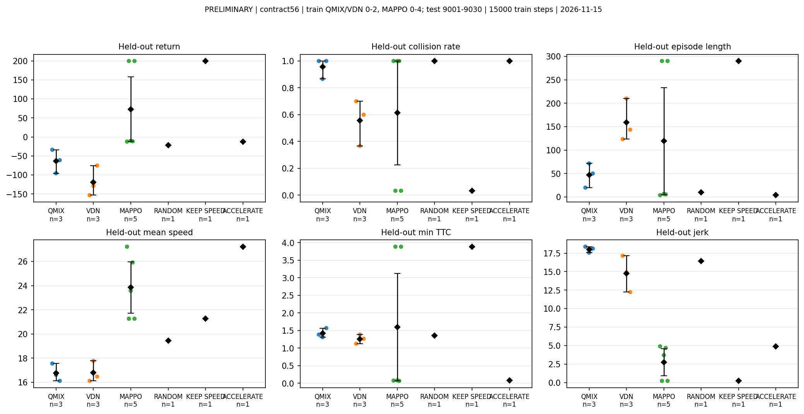
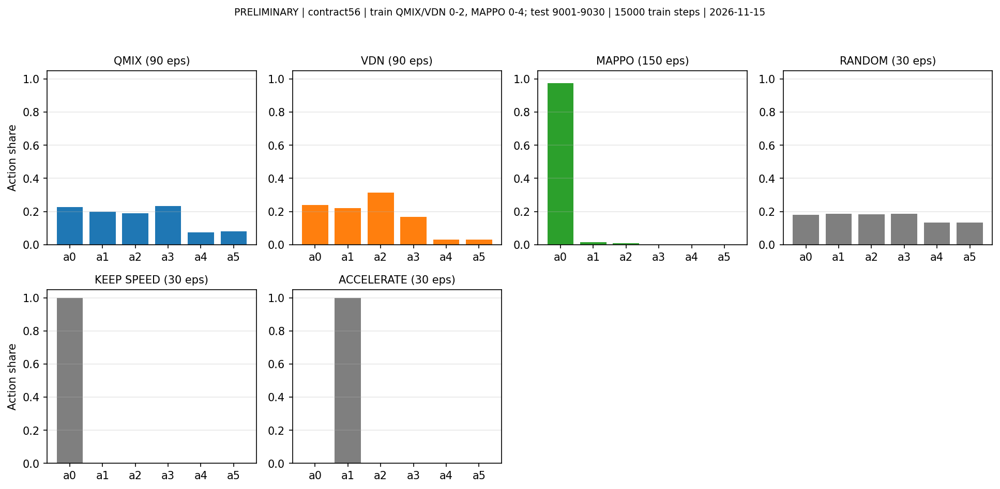
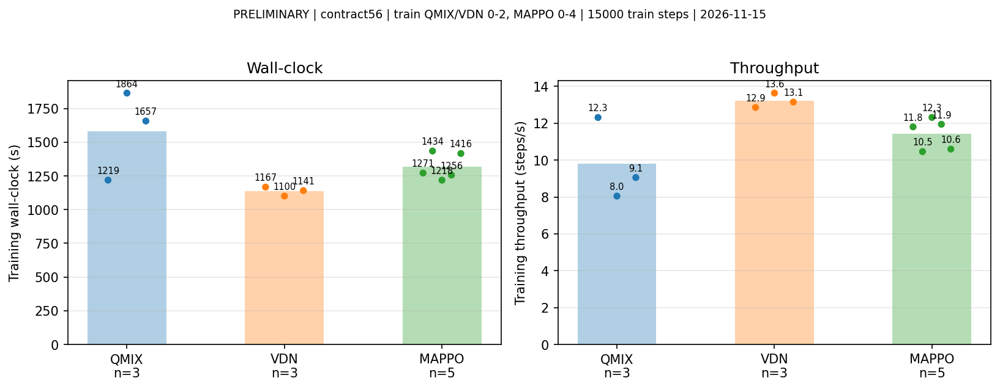

# Three-way comparison: QMIX vs VDN vs MAPPO (preliminary)

Generation date: 2026-11-15. Everything here is preliminary. The runs are a
single highway scenario, not CARLA, and the held-out data are greedy
deterministic evaluations of the final checkpoints on seeds 9001-9030.

## Setup and exact config

| Item | Value |
|---|---|
| Observation layout | `contract56`, `obs_dim=56`, `state_dim=20` |
| Actions | 6 discrete actions (`a0`..`a5`) |
| Scenario | Highway, duration 60 s (300 steps max per episode), density 3.0 |
| Background vehicles | 12 |
| Training budget | 15,000 env steps per seed |
| Evaluation during training | Every 3,000 steps on fixed seeds 7001-7003 |
| Held-out test seeds | 9001-9030 (30 episodes per checkpoint) |
| QMIX/VDN train seeds | 0, 1, 2 |
| MAPPO train seeds | 0, 1, 2, 3, 4 |
| Device | CPU, 2 PyTorch threads |
| QMIX/VDN learner | replay 5000, batch 128, hidden 128, mixing 32, hypernet 64 |
| QMIX/VDN optimisation | lr 3e-4, gamma 0.99, tau 0.01, epsilon end 0.05, `double_q=False`, `state_norm=False`, `reward_scale=0.1` |
| MAPPO learner | rollout 1024, 4 PPO epochs, minibatch 256, clip 0.2, gamma 0.99, GAE lambda 0.95, lr 3e-4, entropy 0.01, grad clip 0.5, hidden 128, `reward_scale=0.1`, `state_norm=False` |
| Logged return | Unscaled team return, so QMIX/VDN/MAPPO are comparable |

The training metadata is in `results/raw/comparison/run_metadata.json` and
`results/raw/comparison/run_metadata_mappo.json`. Raw metrics, checkpoints and
held-out episode rows are ignored by git under `results/raw/`.

## Metrics

Values are means over held-out test episodes. For learners the 95% interval is
a seed-level bootstrap over the listed training seeds, so it shows seed-to-seed
variation. Reference rows are single deterministic rollouts over the same 30
test seeds, so their seed-level interval is degenerate and is omitted.

| Group | Seeds | Episodes | Return | Collision | Length | Mean speed | Min TTC | Jerk |
|---|---|---:|---:|---:|---:|---:|---:|---:|
| QMIX | 0-2 | 90 | -63.32 [-95.35, -33.62] | 0.956 [0.867, 1.000] | 47.2 [19.9, 71.5] | 16.76 [16.11, 17.55] | 1.42 [1.31, 1.57] | 18.02 [17.57, 18.38] |
| VDN | 0-2 | 90 | -118.95 [-153.16, -75.18] | 0.556 [0.367, 0.700] | 159.0 [123.5, 210.0] | 16.79 [16.12, 17.77] | 1.26 [1.12, 1.39] | 14.76 [12.23, 17.15] |
| MAPPO (paired set) | 0-2 | 90 | 59.20 [-12.17, 199.74] | 0.678 [0.033, 1.000] | 100.1 [3.7, 290.3] | 24.02 [21.26, 27.23] | 1.35 [0.076, 3.887] | 2.94 [0.223, 4.897] |
| MAPPO (all runs, supplementary) | 0-4 | 150 | 73.21 [-11.29, 157.80] | 0.613 [0.227, 1.000] | 119.2 [4.9, 233.5] | 23.85 [21.73, 25.98] | 1.60 [0.075, 3.126] | 2.744 [0.919, 4.570] |
| Random | - | 30 | -21.40 | 1.000 | 9.5 | 19.45 | 1.358 | 16.44 |
| Keep-speed | - | 30 | 199.74 | 0.033 | 290.3 | 21.26 | 3.887 | 0.223 |
| Accelerate | - | 30 | -12.17 | 1.000 | 3.7 | 27.23 | 0.076 | 4.897 |

| Group | a0 | a1 | a2 | a3 | a4 | a5 |
|---|---:|---:|---:|---:|---:|---:|
| QMIX | 0.227 | 0.199 | 0.189 | 0.233 | 0.073 | 0.079 |
| VDN | 0.238 | 0.220 | 0.314 | 0.168 | 0.031 | 0.030 |
| MAPPO (0-2) | 0.966 | 0.018 | 0.015 | 0.000 | 0.000 | 0.000 |
| MAPPO (0-4) | 0.976 | 0.016 | 0.008 | 0.000 | 0.000 | 0.000 |
| Random | 0.180 | 0.186 | 0.184 | 0.186 | 0.132 | 0.133 |
| Keep-speed | 1.000 | 0.000 | 0.000 | 0.000 | 0.000 | 0.000 |
| Accelerate | 0.000 | 1.000 | 0.000 | 0.000 | 0.000 | 0.000 |

The MAPPO aggregate is a mixture, not a single policy. The per-seed return,
collision rate, length and `a0` share are:

| MAPPO seed | Return | Collision | Length | Mean speed | Min TTC | Jerk | a0 share |
|---|---:|---:|---:|---:|---:|---:|---:|
| 0 | -12.17 | 1.000 | 3.7 | 27.23 | 0.076 | 4.897 | 0.000 |
| 1 | 199.74 | 0.033 | 290.3 | 21.26 | 3.887 | 0.223 | 1.000 |
| 2 | -9.97 | 1.000 | 6.4 | 23.58 | 0.083 | 3.701 | 0.000 |
| 3 | -11.29 | 1.000 | 5.4 | 25.92 | 0.067 | 4.678 | 0.244 |
| 4 | 199.74 | 0.033 | 290.3 | 21.26 | 3.887 | 0.223 | 1.000 |

## Paired differences over seeds 0-2

Differences are left minus right; positive means the left algorithm is higher.
Intervals are 95% bootstrap CIs over the three paired seed means. All return
differences exclude zero, but see the honest reading before treating that as a
win.

| Metric | QMIX - VDN | MAPPO - VDN | MAPPO - QMIX |
|---|---:|---:|---:|
| Return | +55.63 [14.19, 119.54] | +178.15 [65.21, 328.26] | +122.52 [21.45, 295.09] |
| Collision | +0.400 [0.300, 0.500] | +0.122 [-0.333, 0.400] | -0.278 [-0.833, 0.000] |
| Length | -111.87 [-138.50, -93.53] | -58.92 [-137.17, 80.23] | +52.94 [-43.63, 218.73] |
| Mean speed | -0.026 [-1.156, 1.432] | +7.236 [3.491, 11.111] | +7.262 [4.647, 9.679] |
| Min TTC | +0.163 [-0.075, 0.304] | +0.090 [-1.183, 2.501] | -0.073 [-1.487, 2.576] |
| Jerk | +3.263 [1.231, 5.894] | -11.818 [-14.680, -8.524] | -15.081 [-17.344, -13.481] |

Intervals that contain zero: QMIX-VDN mean speed and min TTC; MAPPO-VDN
collision, length and min TTC; MAPPO-QMIX collision, length and min TTC.

## References and collapse flags

Reference differences use the paired MAPPO seeds 0-2 and the 30 test seeds:

| Comparison | Return difference | Collision difference | Outcome |
|---|---:|---:|---|
| QMIX vs random | -41.92 [-58.84, -27.14] | -0.044 [-0.089, -0.011] | Worse return, slightly lower collision |
| VDN vs random | -97.55 [-119.25, -76.72] | -0.444 [-0.533, -0.356] | Worse return, lower collision |
| MAPPO vs random | +80.60 [74.01, 85.77] | -0.322 [-0.333, -0.300] | Better return and lower collision |
| QMIX vs keep-speed | -263.06 [-288.41, -235.60] | +0.922 [0.844, 0.978] | Worse return and higher collision |
| VDN vs keep-speed | -318.69 [-342.75, -294.17] | +0.522 [0.389, 0.633] | Worse return and higher collision |
| MAPPO vs keep-speed | -140.54 [-149.18, -127.98] | +0.644 [0.600, 0.667] | Worse return and higher collision |

Only MAPPO beats the random reference on return. QMIX and VDN are worse than
random on return despite having lower collision rates. No learner beats
keep-speed on return or collision.

Collapse flags from `results/raw/eval/collapse_check.csv`:

- MAPPO seed 1 and seed 4 are exactly the keep-speed policy: `a0=1.000`,
  return 199.7367, collision 0.0333, length 290.267, mean speed 21.263,
  min TTC 3.887, jerk 0.223. Both are marked
  `collapsed_to_keep_speed=1`.
- MAPPO seeds 0, 2 and 3 are not collapsed: `a0` is 0.000, 0.000 and 0.244;
  returns are -12.17, -9.97 and -11.29; collision is 1.000; lengths are
  3.7-6.4 steps.
- No QMIX or VDN seed collapsed. Their largest `a0` share is 0.410 (VDN seed
  2), and every seed return is below -33.62, far from the keep-speed return.
- The MAPPO 0-2 aggregate is dominated by `a0` (0.966) only because one of the
  three paired seeds is a keep-speed clone. Across all five seeds `a0=0.976`.

## Figures







The training and evaluation curves are in `results/raw/plots/`:
`training_return_curve.png`, `eval_return_curve.png` and
`eval_collision_curve.png`. Every figure title carries `PRELIMINARY`, the
observation layout, the training/test seeds, the 15,000-step budget and the
generation date. Raw plots are not committed.

## Honest reading

Keep-speed is the bar to beat, and it is a degenerate bar: it chooses `a0` on
every step, survives the full 300-step horizon, has the lowest collision rate
and jerk, and returns 199.74. No learner beats it on return or collision. The
scenario therefore has a trivial survival optimum, and none of these learners
has demonstrated a competent driving policy.

MAPPO is bimodal. Two of five seeds reproduce keep-speed exactly; the other
three crash within a few steps. Its aggregate return is positive only because
of those two clones. At 15,000 steps MAPPO receives about 15 PPO updates
(rollout 1,024), so this budget is very small for on-policy learning.

The paired return CIs exclude zero, which mechanically orders the algorithms,
but this is not evidence of a learned winner. The MAPPO advantage over QMIX and
VDN is exactly the keep-speed clone on one of the three paired seeds, and the
seed-level MAPPO return interval includes zero. QMIX has a higher return than
VDN but also a much higher collision rate (0.956 vs 0.556), shorter episodes
and higher jerk; that is not a safety win. We do not declare a winner.

## Limitations

- No goal or success metric. The reward rewards speed and penalises collision,
  so the comparison cannot show whether any policy reaches a destination.
- Keep-speed is a trivial optimum under this reward and scenario.
- The scenario is crash-dominated for random (collision 1.000, length 9.5) and
  uses density 3.0 with 12 background vehicles.
- The paired comparison has only three seeds for QMIX/VDN and MAPPO 0-2. MAPPO
  has two extra seeds but they are not in the paired test.
- CPU-only budget: roughly 18-31 min per QMIX/VDN seed and 20-24 min per MAPPO
  seed; MAPPO gets only about 15 updates.
- Held-out evaluation is deterministic greedy on 30 test seeds per checkpoint.
  It is not a distribution of driving conditions.
- All results are preliminary and were generated from the raw files under
  `results/raw/`, which are not tracked.

## Reproduction

The comparison figures were generated with:

```text
python scripts/plot_comparison.py --input results/raw/comparison \
  --eval results/raw/eval/heldout_episodes.csv --output results/raw/plots
```

The source tables are `results/raw/eval/summary.csv`,
`results/raw/eval/paired_differences.csv`,
`results/raw/eval/reference_comparison.csv`,
`results/raw/eval/collapse_check.csv` and
`results/raw/eval/heldout_episodes.csv` (420 held-out episodes).
